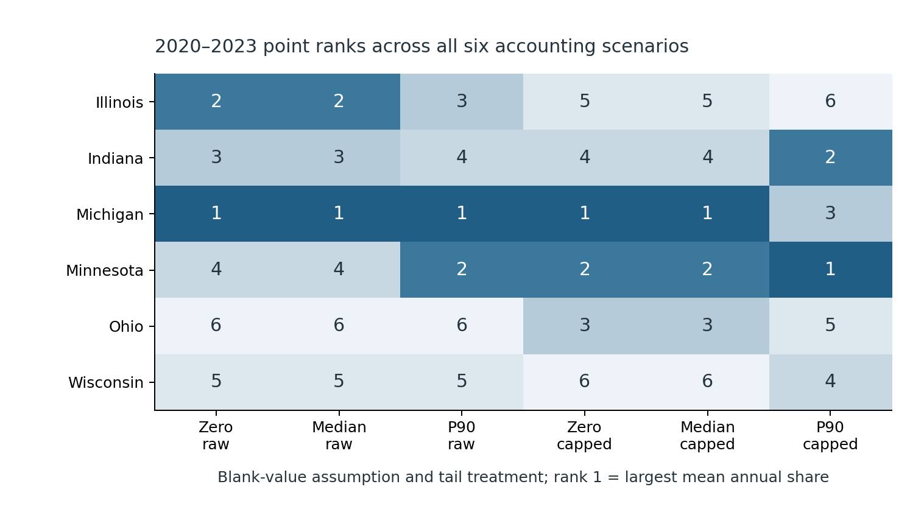
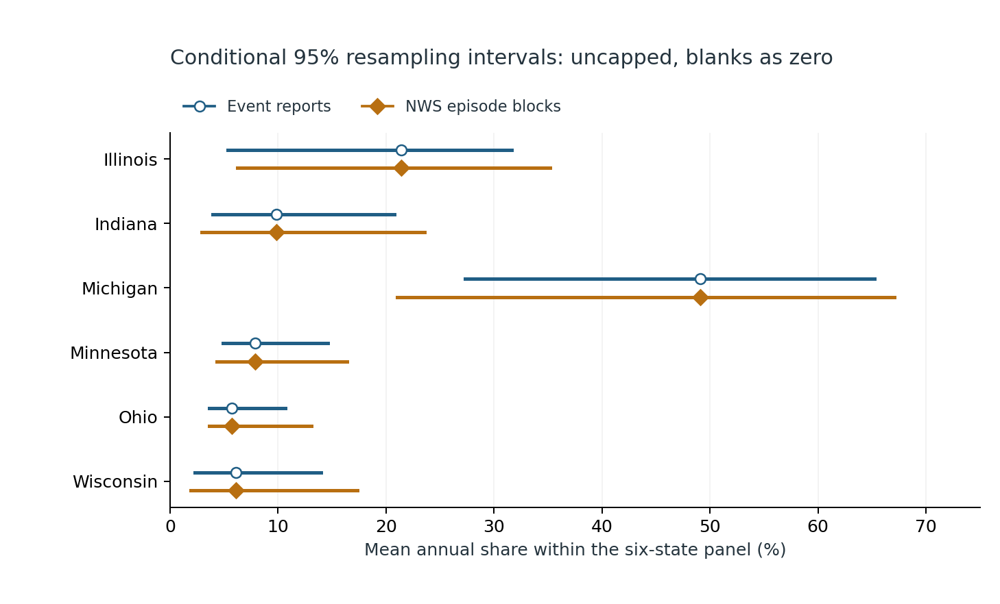
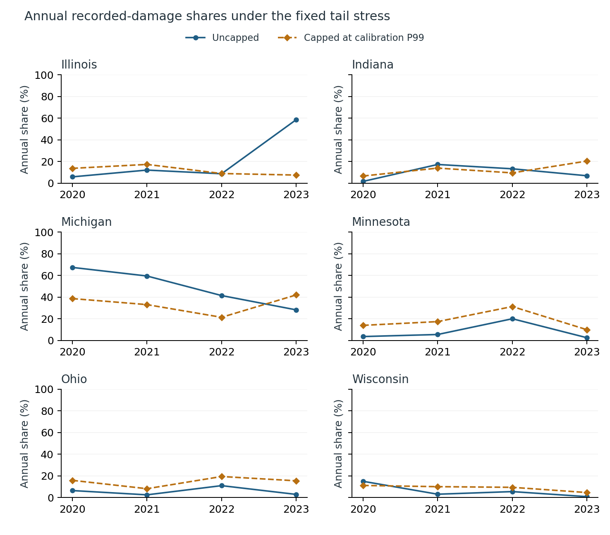

# Storm-damage rankings under incomplete reporting

An analyst using storm-damage tables needs to know whether a regional ordering reflects broad evidence or a few extreme and incompletely recorded reports. This fixed six-state comparison uses five county-designated event types, 2015–2019 scenario calibration and 2020–2023 evaluation. The primary score is an equal-year mean share within Illinois, Indiana, Michigan, Minnesota, Ohio and Wisconsin.

**Finding:** Illinois ranges from second to sixth across six fixed reporting/tail scenarios; Michigan ranks first in five scenarios but third under the combined P90 blank assignment and tail cap. Under the uncapped, blank-as-zero comparator, Michigan has a 49.1% mean annual share and a 46.1 percentage-point episode-bootstrap interval width, compared with 37.9 points when reports are resampled independently. All six comparator intervals widen under episode blocks in this finite run.

Investigate reporting completeness and influential records before using the ordering to prioritize further data review. Retain uncapped recorded totals alongside sensitivity results; a cap changes the estimand and can suppress important catastrophe losses. These results are conditional on the chosen report process and scenario conventions. They do not identify true risk, actual missing loss, expected insured loss, loss per exposed asset, future hazards or a financial allocation. In the evaluation panel, 2,435 of 20,289 reports have blank damage and 12,032 explicitly report zero. Neither unreported events nor ambiguous zeros are resolved by the blank-only scenarios.

Read the [eight-page independent manuscript](paper/manuscript.pdf), [fixed protocol](PROTOCOL.md), [source context](SOURCES.md), [data rights](DATA_RIGHTS.md) and [review receipt](paper/REVIEW.json). This is independent, AI-assisted research, not peer reviewed, an official NOAA product or a journal submission. Exact-head Linux CI, merged/tested-tree and annotated-tag verification remain required before counting a release.







The [source manifest](data/source/manifest.json) records nine exact annual details files and a minimized public subset of 44,666 reports. [Coverage](results/source_coverage.csv) preserves every state/year cell and blank/zero/positive count. Full originals remain outside Git; [the extraction certificate](results/ORIGINAL_EXTRACTION_CHECK.json) records independent comparison of all 401,994 selected original fields. Narratives, precise locations, injuries/deaths, person-level tables and source papers are excluded. Public replay checks the minimized snapshot; it does not reread the excluded full originals or certify their measurement accuracy.

[Calibration](results/calibration.json) retains all eleven earlier-period threshold values, with [every positive calibration observation](results/calibration_positives.csv). The common event cap is $2,791,000. Thresholds are prespecified sensitivity conventions, not optimized or fitted estimates of missing losses. [Code freeze](results/CODE_FREEZE.json) predates every evaluation damage-total, rank and bootstrap command. Only declared source coverage/format counts used evaluation rows earlier.

[Evaluation exports](results/evaluation) preserve every scenario, integer unit vector, annual bootstrap cent total, replicate score/rank, conditional interval, paired contrast, rank frequency and annual/leave-year-out result. [Development exports](results/development) preserve the earlier five-year run. There are 1,000 replicates for each of the two resampling units, paired across all six scenarios; frequency granularity is 0.1 percentage point and the maximum Monte Carlo standard error is about 1.6 points. NWS episodes do not provide complete cross-office disaster lineage, and within-year exchangeability is an assumption.

## Reproduce the retained edition

Use Python 3.10 and the pinned requirements. The public analysis needs no new source retrieval or credentials.

```sh
python -m pip install -r requirements.txt
python -m unittest discover -s tests -v
python src/check_reproduction.py
python src/verify_figures.py
python src/verify_paper.py
python src/verify_public_package.py
```

Eight boundary tests check units, blanks/zeros, quantiles/rounding, capping, equal-year weights, ties and cross-state episode preservation. Independent SQL/rational/indexed-row reconstruction checks 874,218 development and 738,546 evaluation values. Cents and ranks require exact equality; floating comparisons retain absolute 1e-7 / relative 1e-9 tolerances. Both paths use documented NumPy PCG64 streams; this is not independent certification of the RNG library. Fresh replay rebuilds 1,855,811 exact cent/discrete fields and 147,422 floating fields. The publication checker verifies the reviewed canonical Git edition, approved paper hashes and bounded exclusions; it is not universal privacy or security detection.

To recheck extraction against full originals, download the nine exact URLs from the manifest to a folder outside this checkout, preserving their filenames and hashes. Run `python src/verify_extraction.py --private-source` with that external folder as its argument. Do not place the originals in this repository. The acquisition script documents the initial sequential capture and minimization; replay never silently refreshes a retained vintage.

To regenerate figures, run `python src/figures.py`, then `python src/verify_figures.py`. Compile `paper/main.tex` separately with LaTeX/Tectonic and the output directory `paper/`, then rename `main.pdf` to `manuscript.pdf`. A rebuilt PDF requires fresh rendered review and an updated exact-hash publication scope. CI reproduces the numerical analysis and checks the retained reviewed PDF; it does not recompile the manuscript.

Only this reviewed independent study is authorized for public release here. Separate formal-publication projects, including Azure optimization, remain private.
